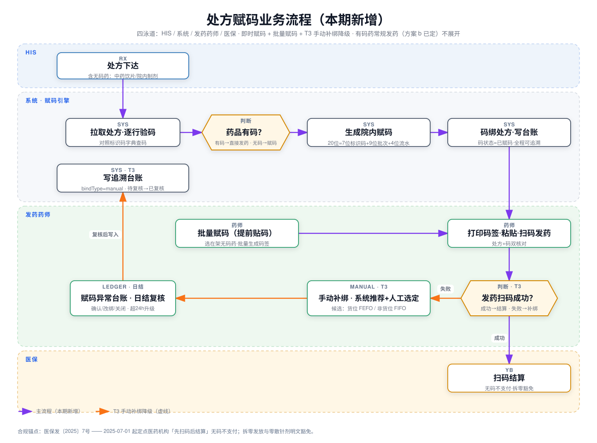

# 处方赋码 PRD（预览稿）

> Version: V0.2
> Date: 2026-09-26
> Author: PM + Claude
> Related: [prototypes/shared/diagrams/fireworks/04-dispensing.svg](../../prototypes/shared/diagrams/fireworks/04-dispensing.svg)（发药主流程·方案 b 已定）

---

## 一、背景与问题（Problem）

### 背景

系统已实现「码进药出」全链路（采购 → 库房 → 药房 → 发药），但院内无码药品（中药饮片、院内制剂、供应商未赋码品种）没有追溯码，发药环节无法扫码，追溯链在此断裂；医保发〔2025〕7 号要求「先扫码后结算」，无码药品的处方在结算环节被拦。

### 用户痛点

> **痛点 1：无码药追溯断链** —— 无码药品发药无任何扫码记录，出问题无法溯源到批次。
>
> **痛点 2：医保结算被拦** —— 无码不支付，收费处只能退费改方，患者往返窗口。
>
> **痛点 3：豁免边界靠人脑** —— 哪些拆零药属于医保豁免，药师只能凭记忆判断，口径不一。

---

## 二、用户故事（User Stories）

### 用户故事 1（P1）：发药时无码药即时赋码

作为发药药师，在门诊发药遇到无码药品时，我希望能现场生成院内码、打印粘贴并完成扫码发药，以便处方正常结算、追溯不断链。

**独立验收：** 只做本故事，一张含无码药的处方即可完整走完「赋码 → 贴码 → 扫码发药 → 结算」。

**验收标准：**
- Given 处方行药品在标识码字典中无码，When 药师在发药页点击「赋码」，Then 系统生成 20 位院内码并弹出码签打印预览。
- WHEN 院内码已粘贴并扫码核对，THE SYSTEM SHALL 将码与处方绑定并写入台账，且 SHALL NOT 允许同一码绑定第二张处方。
- IF 药品被标记为「拆零豁免」，THEN THE SYSTEM SHALL 不触发赋码，直接按拆零流程发放。

### 用户故事 2（P2）：在架无码药批量赋码

作为药房管理员，在发药高峰前，我希望对药房在架的无码药品批量生成并打印码签，以便高峰发药不卡在赋码环节。

**独立验收：** 只做本故事，在架无码药可批量生成码签并贴码上架，发药时直接扫已贴码。

**验收标准：**
- Given 在架药品清单中存在无码药，When 管理员勾选药品并设置每种数量，Then 系统批量生成院内码并汇成打印任务。
- WHEN 某药品赋码数量超过其在架数量，THE SYSTEM SHALL 拦截并提示在架余量。

### 用户故事 3（P3）：赋码记录可追溯

作为质控管理员，在核查药品流向时，我希望赋码记录进入统一台账查询，以便院内码与厂商码同口径追溯。

**独立验收：** 只做本故事，追溯码查询页可查到院内赋码的码及其绑定处方。

**验收标准：**
- Given 一条院内赋码记录，When 在追溯码查询页输入该码，Then 展示码来源（院内赋码）、绑定处方号、操作人与时间。

---

## 三、方案概述（Solution）

> **核心功能一句话描述** —— 为院内无码药品提供「即时赋码 + 批量赋码」双通道，让每一盒发出的药都有码可扫、可结算、可追溯。

### 流程图（按信号触发：多角色 + 状态流转）

| 流程节点 | 页面/角色 | 用户行为 | 分支条件 | 异常去向 |
|---------|----------|---------|---------|---------|
| 处方下达 | HIS | 医生开方 | 含无码药才进入本流程 | 有码 → 方案 b 常规发药 |
| 拉取处方·逐行验码 | 系统 | 拉取处方对照标识码字典 | 药品有码？ | 字典缺失 → 进异常码维护 |
| 生成院内赋码 | 系统 | 20 位=7 位标识码+9 位批次+4 位流水 | 拆零豁免药不赋码 | 流水冲突 → 重取号 |
| 码绑处方·写台账 | 系统 | 码状态=已赋码，写追溯台账 | — | 处方已退 → 赋码作废 |
| 批量赋码（提前贴码） | 发药药师 | 选在架无码药批量生成码签 | 赋码数 ≤ 在架数 | 超量拦截 |
| 打印码签·粘贴·扫码发药 | 发药药师 | 打印、粘贴、扫码双核对 | — | 打印失败 → 重打原码 |
| 扫码结算 | 医保 | 码随处方上传 | 拆零豁免直接结算 | 无码 → 不支付 |

### 升级点清单

- 4.1 新增处方即时赋码（发药环节触发）
- 4.2 新增在架药品批量赋码
- 4.3 赋码记录接入台账追溯查询

拆解回检：故事 1 → 4.1；故事 2 → 4.2；故事 3 → 4.3。每个 P1/P2 故事均有承接。

---

## 四、功能需求（Feature Requirements）

## 4.1 新增处方即时赋码

### 功能说明
发药药师在处方发药页对无码药品一键生成院内码、打印码签并扫码绑定，不发新页面，挂在既有处方发药页（disp）。拆零豁免药品不触发赋码。

**独立验收：** 只做本升级点，含无码药的处方可完整走完赋码 → 贴码 → 扫码发药 → 结算。

1. 列表（处方发药页明细行）
   1. 行状态标签（新增）：无码（橙）/ 豁免（灰）/ 已赋码（绿）；有码药品不显示标签
2. 按钮
   1. 赋码（新增）：无码药品行内显示；点击弹出赋码弹窗；处方已退时禁用，悬浮提示「处方已退」
3. 表单内容（赋码弹窗）
   1. 药品信息
      1. 药品名称
         1. 格式：文本框（自动带入不可手动修改）
         2. 提示内容：处方行自动带入
         3. 必填项
         4. 限制：无
      2. 批次
         1. 格式：下拉选择框
         2. 提示内容：请选择批次
         3. 必填项
         4. 选择项：该药在架批次，默认 FEFO 最近效期批次
      3. 有效期至
         1. 格式：日期选择框
         2. 提示内容：请选择有效期
         3. 必填项
         4. 限制：不得早于当前日期；≤180 天黄字预警；随批次自动带入可改
      4. 赋码数量
         1. 格式：数字输入框
         2. 提示内容：请输入赋码数量
         3. 必填项
         4. 限制：正整数，默认=处方行数量，不得大于该批次在架数量，超出红字拦截
      5. 院内码
         1. 格式：文本框（自动生成不可手动修改）
         2. 提示内容：确认生成后自动展示
         3. 必填项
         4. 限制：20 位=7 位标识码+9 位批次+4 位流水；[假设]标识码段 9 开头区隔厂商码
4. 表单按钮
   1. 取消：关闭弹窗，不生成码
   2. 确认生成：
      1. 前端：必填与数量校验，失败 toast 精确文案（如「赋码数量不能大于在架数量 X」）；成功后生成院内码并进入打印预览
      2. 后端：在架数量复核；生成院内码（流水号互斥）；码状态=已赋码
   3. 打印（生成成功后进入打印预览）：
      1. 前端：调系统打印；失败 toast「打印失败，可重打原码」，重打不生成新码
      2. 打印份数：选填，整数，默认 1，上限 5
   4. 扫码绑定（打印粘贴后）：
      1. 前端：扫已贴码与弹窗码比对，一致则行标签变绿「已赋码」；不一致红字「码与药品不符」
      2. 后端：码与处方绑定（一处方一码），同一码绑定第二张处方时硬拦截

## 4.2 新增在架药品批量赋码

### 功能说明
药房管理员对当前药房在架无码药品批量生成并打印码签，提前贴码上架，发药时直接扫已贴码。新页面，挂在发药管理 > 批量赋码（菜单已占位）。

**独立验收：** 只做本升级点，在架无码药可批量赋码贴码，发药页扫码直接命中。

1. 搜索栏
   1. 药品名称：模糊搜索
   2. 批次：模糊搜索
   3. 赋码状态：下拉选（未赋码/部分赋码/已足量）
2. 按钮
   1. 批量生成（新增）：勾选药品后可用；生成中按钮 loading，禁止重复提交
   2. 打印全部（新增）：批量生成成功后可用，连续打印码签
3. 列表（按有效期升序，FEFO）
   1. 勾选框（新增）：仅无码药品行可勾选
   2. 药品名称 / 规格 / 批次：保留原有功能
   3. 在架数量：保留原有功能
   4. 已赋码数量（新增）：该药品该批次累计已赋码数，防重复赋码
   5. 赋码数量（新增）：行内数字输入，默认=在架余量，不得大于在架余量
   6. 赋码状态（新增）：未赋码（橙点）/ 部分赋码（黄点+数量比）/ 已足量（绿点）
4. 表单按钮
   1. 批量生成：
      1. 前端：勾选与数量校验，失败 toast 精确文案（如「唯可来：赋码数量超过在架余量 3」）；成功 toast「已生成 N 张码签」并进入打印任务
      2. 后端：逐药品复核在架余量；批量生成院内码（流水互斥）；码状态=已赋码
   2. 打印全部：
      1. 前端：连续调系统打印；单张失败记入失败清单，打印结束 toast「成功 X 张，失败 Y 张，可重打」

## 4.3 赋码记录接入台账追溯查询

### 功能说明
院内赋码的码写入统一追溯台账，在既有「追溯码查询」页可查，与厂商码同口径展示来源与绑定处方。不新建页面，扩展现有追溯码查询（trace-q）。

**独立验收：** 只做本升级点，院内码可在追溯码查询页完整查出来源与生命周期。

1. 搜索栏
   1. 追溯码：精确搜索（保留原有功能，兼容 20 位院内码）
2. 列表（查询结果）
   1. 来源（优化）：新增枚举值「院内赋码」，与「采购入库」「其他入库」并列展示
3. 详情
   1. 院内赋码徽标（新增）：详情头部蓝色徽标，与厂商码视觉区分
   2. 展示字段（新增）：绑定处方号、操作人、赋码时间、发药时间、结算状态

### 边界与异常

1. 拆零豁免药品：药品字典带豁免标记的不触发赋码，直接按拆零流程发放（splitQty 记消耗）。
2. 重复赋码：同一码绑定第二张处方时硬拦截。
3. 处方作废：赋码后 HIS 退方，已赋码自动作废并写台账（状态=已作废），码不复用。
4. 打印异常：打印失败可重打原码，禁止重新生成新码（防一药多码）。
5. 并发赋码：同一药品并发生成时流水号互斥，冲突自动重取。
6. 效期缺失：批次无效期数据时强制手填，不托底。

### Non-Goals（本次明确不做）

- 不做码签打印机驱动层对接（走操作系统打印，型号适配见开放问题）。
- 不做供应商/院外环节的赋码（采购侧已有码单池）。
- 不做病区侧赋码（病区段按已拍板的两段式，码随发药单绑患者）。
- 不做豁免清单的自动判定（本期由药品字典人工维护标记）。

---

## 五、技术与数据需求

### 5.1 数据与业务逻辑
- 院内码写入追溯码台账（TRACE_CODE），来源字段 source=院内赋码；码状态机：已赋码 → 已发药（随处方）→ 已结算；作废为终态不可复活。
- 赋码数量不得超该批次在架数量；在架口径沿用现有库存推导（入库−出库−损耗−盘亏）。
- 豁免标记挂在药品字典（DRUGS），发药验码与批量赋码清单共用此标记。
- [假设] 院内码 20 位编码沿用现有追溯码规则，标识码段以 9 开头区隔厂商码，避免与采购码碰撞。

### 5.2 接口诉求（PM 业务层）
- 新增：院内码生成接口（入：药品+批次+数量；出：码清单），要求批量 100 张内秒级返回。
- 新增：码-处方绑定/解绑接口（随发药、退方联动）。
- 复用：医保上传走既有结算通道，院内码与厂商码同字段上传。
- 台账查询接口扩 source 枚举。
> ⚠️ 接口路径、入参出参、流水号生成方案由开发补充。

### 5.3 非功能需求（按需激活）
- 性能：单次赋码生成 < 1s；批量 100 张生成 < 5s。
- 兼容：码签打印兼容 Windows 通用打印，不绑定特定打印机驱动。

---

## 六、成功指标（可选）

| 指标名称 | 目标值 | 验证功能 | 追踪周期 |
|----------|--------|----------|----------|
| 无码药处方扫码结算通过率 | ≥ 98% | 4.1 | 上线后 4 周 |
| 高峰单张处方平均发药时长增幅 | ≤ 30 秒 | 4.1 / 4.2 | 上线后 4 周 |

---

## 七、开放问题与假设

**开放问题**
1. 中药饮片是否在医保豁免清单内，口径待医保办书面确认。
2. 院内码是否需要上传省级药品追溯平台，还是仅院内闭环。
3. 码签规格（尺寸/材质）与现有打印机型号是否兼容。

**假设清单**
- [假设] 院内码 20 位编码沿用现有追溯码规则，标识码段以 9 开头区隔（见 4.1 字段、5.1）。
- [假设] 拆零豁免标记由药品字典人工维护，本期不做自动判定（见 Non-Goals）。
- [假设] 医保上传通道可直接复用，无需新增结算接口（见 5.2）。
